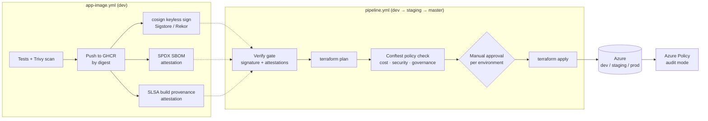

# Case study: a secure software supply chain for Azure, on a free tier

[](https://github.com/vaibhavmahna/DevSecOps-Terraform/actions/workflows/pipeline.yml)
[](https://github.com/vaibhavmahna/DevSecOps-Terraform/actions/workflows/app-image.yml)


Three Azure environments (dev, staging, prod), each in its own subscription, are
deployed only by CI/CD. A container image can reach them only if it was built
by this repository's own workflow, signed, and given an SBOM and build
provenance. Every Terraform plan is checked by policy as code before it is
applied, and Azure Policy keeps checking what is actually running afterwards.
Everything runs on free tiers.

## The problem

A pipeline that can deploy anything is a supply-chain risk:

- **Tampered or unknown images.** A tag like `:latest`, or even a commit SHA,
  says nothing about who built the image or from what source.
- **Secrets in code and pipelines.** Connection strings and keys end up in
  variables, logs, or Terraform state.
- **Configuration drift.** Insecure or expensive settings slip in through a
  plan nobody reads closely, or through the portal.
- **Too much access.** CI identities are often Owner on the subscription.

## What I built



### 1. Signed, attested images
- `app-image.yml` builds the app, runs tests and a Trivy scan, and pushes the
  image to GHCR.
- The image is **signed with cosign keyless** (Sigstore). The workflow's OIDC
  identity is the signer, so there is no key to leak. The signature is recorded
  in the public Rekor transparency log.
- Two attestations are pushed with the image: an **SPDX SBOM** (Syft) and **SLSA
  build provenance** (`actions/attest-build-provenance`).

### 2. A verify gate before every deploy
- A composite action (`.github/actions/verify-images`) finds every
  `ghcr.io/...` image the Terraform code references.
- It requires a full 40-character commit tag and checks:
  - `cosign verify`: the signer must be exactly
    `app-image.yml@refs/heads/dev` in this repository.
  - `gh attestation verify`: provenance from the same workflow.
- If any image fails, the deploy stops. It is the one blocking control,
  on purpose. Deployments reference images **by digest**, so what was verified
  is what runs.

### 3. Policy as code on every plan
OPA/Conftest rules in `policies/terraform/` check `terraform show -json` output:

| Area | Rules |
|---|---|
| Cost | Free-tier SKUs only, scale-to-zero container apps, ≤ 0.25 vCPU, LRS storage, ≤ 31-day log retention, a budget must exist |
| Security | Key Vault purge protection + RBAC, storage HTTPS / TLS 1.2 / no public containers, HTTPS-only web apps, no plain-text secret env vars (only the name is reported, never the value) |
| Governance | Required tags (`environment`, `project`, `managed_by`), allowed region only |

- The policies have **22 unit tests**, which run as a blocking PR check. A mutation
  test confirmed that breaking a rule makes its tests fail.
- Findings are `warn` (report-only) and appear in the run summary. The plan JSON
  can contain sensitive values, so it is deleted right after the check.
- The first real run found an actual issue: the storage module allowed public
  containers (provider default). It was fixed in the module and released as
  `modules-v1.3.0`.

### 4. Azure Policy for what is actually running
- Conftest only sees changes made through Terraform.
- Built-in Azure Policy definitions are therefore assigned to each resource group
  in **DoNotEnforce** mode. They report compliance, including changes made by
  hand in the portal, without blocking anything:
  - allowed locations and required tags
  - Key Vault purge protection and RBAC
  - storage public access and HTTPS
  - web app HTTPS

### 5. No secrets in code, pipelines or state
- **Azure login uses OIDC** workload identity federation. No client secret is
  stored anywhere.
- **App secrets live in Key Vault.**
  - A signing key is generated with an *ephemeral* `random_password` and
    written with a write-only attribute (`value_wo`), so it never enters
    Terraform state.
  - The container app reads secrets through Key Vault references using its
    own managed identity.
- **Gitleaks** and **Checkov** scan every PR.

### 6. Least privilege for the pipeline
- The pipeline identity is **not Owner**.
- It can create role assignments only through *Role Based Access Control
  Administrator* with an **ABAC condition**: it may grant only *Key Vault
  Secrets User* and *Key Vault Secrets Officer*, and nothing else.

## Delivery model
- **One branch per environment:** `dev` → dev, `staging` → staging,
  `master` → prod. Each environment has its own subscription and its own state
  storage, and needs a **manual approval** to deploy.
- **Shared module library:** reusable modules are pinned by git tag
  (`?ref=modules-vX.Y.Z`). Projects upgrade deliberately, never by accident.
- **Path-based change detection:** only projects whose code or modules changed
  are planned. A policy change re-plans every project.
- **$0 a month:** App Service F1, Container Apps consumption scaling to zero,
  LRS storage, 30-day logs, Key Vault standard, and a budget alert in every
  environment.

## Verify it yourself
```bash
IMG=ghcr.io/vaibhavmahna/plx-devtools:2b09d89ad5f5c070979ef543f3284afab8055332

cosign verify "$IMG" \
  --certificate-identity "https://github.com/vaibhavmahna/DevSecOps-Terraform/.github/workflows/app-image.yml@refs/heads/dev" \
  --certificate-oidc-issuer https://token.actions.githubusercontent.com

gh attestation verify "oci://$IMG" --repo vaibhavmahna/DevSecOps-Terraform
```

## Stack
Terraform (azurerm 4.x) · GitHub Actions · Azure (Container Apps, App Service,
Key Vault, Log Analytics, App Insights, Azure Policy) · Sigstore cosign · Syft ·
GitHub artifact attestations · OPA / Conftest · Trivy · Checkov · Gitleaks

## Next
GitOps on Kubernetes: Argo CD deploying the same signed image, with Kyverno
admitting only images whose signature verifies.
